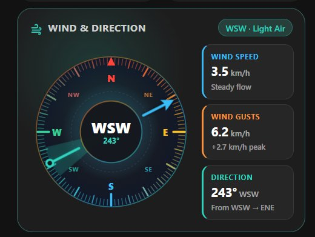

# Sun & Moon Horizon Card (`custom:sun-horizon-card`)

A modern, astronomical custom Lovelace card for Home Assistant displaying solar and lunar positions, real-time horizon trajectory, countdown to the next solar event, and detailed daylight metrics.



## Features

- **Continuous 24h Sine Orbit Trajectory**: Real-time SVG sinusoidal path showing day and night arcs divided by an astronomical horizon threshold line.
- **Dynamic Celestial Positions**: Animated glowing sun orb mapped to true solar elevation along with a real-time moon icon and illumination indicator.
- **Clean Right-Aligned Status Chips**: Top-right status pills displaying solar elevation (`Above Horizon · +21.1°` / `Below Horizon · -13.4°`) and active moon phase without layout wrapping.
- **Event Countdown Strip**: Prominently highlights the upcoming event (`Next Sunrise: in 11h 20m` or `Next Sunset: in ...`) directly above the metric tiles.
- **4-Metric Telemetry Grid**:
  - **Sunrise**: Exact sunrise time with astronomical Dawn sub-label.
  - **Sunset**: Exact sunset time with astronomical Dusk sub-label.
  - **Daylight**: Total daylight duration with remaining/elapsed hours and percentage.
  - **Moon**: Active moon phase name with realistic SVG phase rendering and illumination percentage.
- **Universal Light & Dark Mode**:
  - Automatically syncs with Home Assistant's theme (`hass.themes.darkMode`).
  - Seamlessly respects OS/browser color scheme (`prefers-color-scheme: light`).
  - Optional `theme_mode: light` or `theme_mode: dark` config override.
  - Full WCAG AA contrast compliance with deep amber/blue light-mode accents.
- **Native History Dialogs**: Clicking the celestial arc, title, or any metric tile opens Home Assistant's native `hass-more-info` dialog.

## Installation

### HACS (Custom Repository)

1. Open **HACS** in Home Assistant → **Frontend** → top-right menu (`⋮`) → **Custom repositories**.
2. Add this repository URL with category **Dashboard** (Lovelace).
3. Install **Sun & Moon Horizon Card** and reload your browser.

### Manual Installation

1. Copy `sun-horizon-card.js` to your Home Assistant `config/www/` folder.
2. Add `/local/sun-horizon-card.js` as a **JavaScript Module** under **Settings → Dashboards → Resources**.

## Configuration

```yaml
type: custom:sun-horizon-card
title: Sun & Moon
entity: sun.sun
moon_entity: sensor.moon_phase
```

### Options

| Name | Type | Default | Description |
| :--- | :--- | :--- | :--- |
| `type` | `string` | **Required** | `custom:sun-horizon-card` |
| `title` | `string` | `Sun & Moon` | Card header title |
| `entity` | `string` | `sun.sun` | Sun entity providing solar elevation and sunrise/sunset attributes |
| `moon_entity` | `string` | `sensor.moon_phase` | Moon sensor entity providing phase attribute or state |
| `theme_mode` | `string` | `auto` | Optional theme override: `auto`, `light`, or `dark` |
